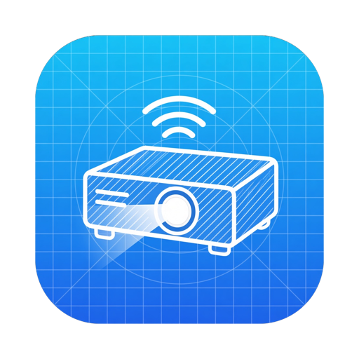

<div align="center">



# Remoty

**A native macOS menu bar remote for Android TV projectors.**
Power, volume, d-pad, apps, text input and brightness, one click away from your Mac.

[](https://github.com/atapinar/Remoty/releases/latest/download/Remoty-macOS-arm64.zip)


[](https://github.com/atapinar/Remoty/releases)
[](LICENSE)

</div>

---

## Why Remoty

Your projector's remote is always on the other side of the room. Remoty lives in your menu bar and talks to the projector over your local network using `adb`. There is no account, no cloud and no analytics. Nothing leaves your network.

## Features

| | |
| --- | --- |
| **Remote** | D-pad, OK, back, home, menu, settings, play/pause, rewind, fast forward, and a keyboard field that types straight into the projector |
| **Power and volume** | Wake and sleep, a volume slider with +/- and mute |
| **Apps** | Launch any app that has a TV launcher entry. Star favorites to pin them. Defaults: YouTube, Netflix, Prime Video, MX Player |
| **Inputs** | HDMI 1, HDMI 2 and the input menu |
| **Picture** | Brightness control (0-255) |
| **Mirror** | Opens Displays settings with AirPlay mirroring guidance |
| **Activity** | Local screen time per app, recorded on your Mac only |
| **Discovery** | Finds projectors on your network, or enter an IPv4 address or `.local` name |

## Install

1. **[Download the latest release](https://github.com/atapinar/Remoty/releases/latest/download/Remoty-macOS-arm64.zip)** and unzip it.
2. Drag `Remoty.app` to your Applications folder.
3. First launch: right-click the app and choose **Open**. Remoty is not notarized by Apple, so macOS asks once. Or run:
   ```sh
   xattr -dr com.apple.quarantine /Applications/Remoty.app
   ```
4. Install `adb` if you do not have it:
   ```sh
   brew install android-platform-tools
   ```

Requires macOS 14 or later on Apple Silicon.

## Connect your projector

1. On the projector, turn on **Developer options**, then **Network debugging** (ADB over network).
2. Click the Remoty icon in the menu bar and open **Settings**.
3. Choose **Find projectors on your network**, or type the projector's IP address. Port 5555 is the default; add `:port` for another.
4. Choose **Save and connect**.
5. The first time, the projector shows a USB debugging prompt. Pick **Always allow from this computer**.

The address is stored in the app's preferences on your Mac. The project ships with no device address.

## Tested versions

| Android TV version | Status |
| --- | --- |
| 13 | Read-only queries verified on one projector: power state, volume, foreground app, app list, brightness |

Commands that change state (key events, volume, app launch, brightness) use standard Android shell commands but are not yet verified on a device. If you try Remoty on another projector, please open an issue with your Android TV version and a redacted error message.

## Known limits

- Power uses `KEYCODE_SLEEP` and `KEYCODE_WAKEUP`. If the projector drops off the network in standby, Remoty cannot wake it.
- Mute sends `KEYCODE_VOLUME_MUTE`. The mute state on screen is a local guess.
- HDMI keycodes work only if the projector firmware maps them.
- Contrast, color, sharpness, keystone and focus are placeholders until the vendor commands are known.
- App icons are drawn from SF Symbols and initials. Remoty does not pull icons from the device.

## Build from source

You need macOS 14+, Xcode Command Line Tools (Swift 5.9+) and `adb`.

```sh
git clone https://github.com/atapinar/Remoty.git
cd Remoty
bash scripts/build.sh
open dist/Remoty.app
```

Checks:

```sh
dist/Remoty.app/Contents/MacOS/Remoty --self-check          # offline parser tests
dist/Remoty.app/Contents/MacOS/Remoty --probe PROJECTOR_IP  # read-only adb queries
```

Do not paste probe output into issues without removing device details such as IP addresses, MAC addresses and serial numbers.

## Privacy

Commands go from your Mac to your projector on the local network. Remoty has no account, no analytics and no telemetry. Usage history stays in a local file on your Mac.

## Credits and license

Released under the [MIT License](LICENSE). Brand logos shown in the app are listed in [THIRD_PARTY_NOTICES.md](THIRD_PARTY_NOTICES.md); they remain trademarks of their owners.

Remoty is a community project, independent of Google and of any projector vendor. Android TV is a trademark of Google LLC.
